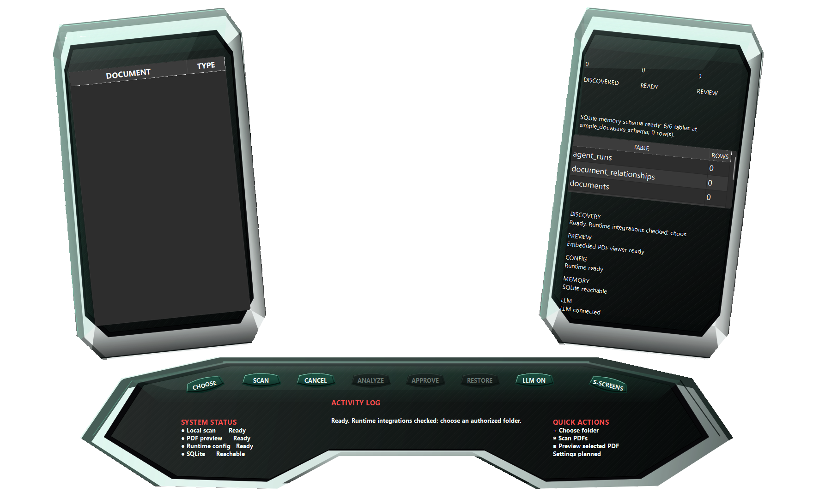

# DocWeave

DocWeave organizes folders of PDF documents using a local language model.
It reads document text, proposes descriptive filenames and folders, and waits
for human approval before moving files. SQLite records proposals, decisions,
original paths, and changes so approved operations can be restored.

The desktop interface uses PySide6. Analysis runs through local Ollama with
`qwen2.5:14b-instruct`. No hosted inference, account, or remote database is
required. The application rejects non-local model and database endpoints.



## Setup on Windows

Install Python 3.12 or later and Ollama. Provision the model once:

```powershell
ollama pull qwen2.5:14b-instruct
python -m venv .venv
.\.venv\Scripts\python -m pip install -r requirements.txt
.\.venv\Scripts\python -m pip install -e .
.\.venv\Scripts\docweave-runtime-preflight --database
.\.venv\Scripts\docweave-desktop
```

Dependency installation and model provisioning need downloads. Once installed,
document processing works locally without internet access. The model is about
9 GB on disk; inference speed and memory use depend on available hardware.
Ollama itself is a separately installed application with its own settings.

Alternatively, run `launch-docweave-dashboard.cmd` from this directory.
The SQLite file is created automatically at `local-data/docweave.db` relative
to the working directory. Keep this file to retain review and restore history.
Back it up together with the document folders while DocWeave is closed.
The database and extracted document metadata are not encrypted by DocWeave;
use operating-system disk encryption and appropriate file permissions.

## Workflow

1. Choose an authorized folder and scan its PDFs.
2. Press **LLM** to check that Ollama and the model are available.
3. Analyze documents and inspect the proposals, evidence, and previews.
4. Approve selected proposals or reject them. The model cannot move files.
5. Use Restore to review and approve returning files to their original paths.

The existing desktop layout and controls are retained. The LLM button checks
local model availability and does not perform a login. The memory status shows
SQLite availability. Model failures are displayed; no canned inference result
or remote fallback is used.

## Limitations

Classification accuracy has not been established on a representative customer
corpus. Confidence is an uncalibrated review-ordering signal. Text extraction
does not provide optical character recognition for scanned images. Poor
extraction, conflicting evidence, unavailable models, and invalid model output
can block analysis. Relationship discovery is not the core product workflow.
Oversized model prompts are rejected before inference to prevent silent
truncation of document evidence; long-document chunking is not implemented.
The application supports local single-user operation; shared-server deployment
and multi-user authentication are outside its current scope.

After the latest local tuning, the comparison PDF took about 10 seconds,
down from 25 seconds after the first tuning. Five warm requests on four selected
PDFs took 9.5-14.3 seconds and passed validation without retries. A real three-file
worker batch persisted all three proposals. These are small-sample measurements,
not a validated accuracy benchmark. The delivery-note corpus label is still
absent from the application taxonomy. See [the latest tuning evidence](docs/performance/response-row-tuning.md).

Short documents use an 8,192-token context. Longer documents receive a larger
context only when their full evidence requires it, up to 32,768 tokens; those
may require system memory and run slower. Inputs beyond the maximum budget
are rejected explicitly. No document text is silently cut to fit.

## Development and verification

```powershell
.\.venv\Scripts\python -m pip install -r requirements-dev.txt
.\.venv\Scripts\python -m pytest
.\.venv\Scripts\python -m ruff check src tests
```

Automated test doubles are used only in tests. Live inference must be tested
separately with the installed Qwen model. See `docs/manual-testing.md` for the
manual acceptance sequence. Current verification results will be recorded in
`docs/verification.md`; do not treat feature descriptions as test evidence.

## License

Source code is licensed under MIT. Ollama, Qwen, Qt/PySide6, and other
dependencies retain their respective licenses. Review model and dependency
licenses before redistribution. Synthetic PDFs are provided for testing;
do not commit private documents or local database files.
